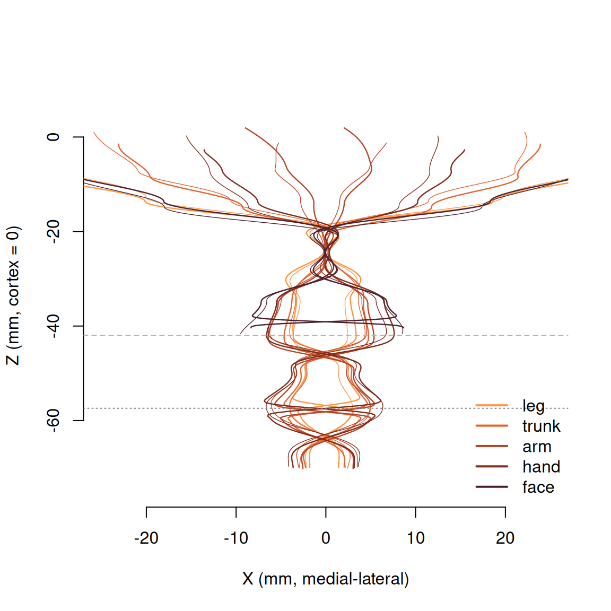

# The pyramidal tract: anatomy and mathematical model

## Scope

This document is the reference for the per-bundle pyramidal-tract (PyT)
module of `master`. It first summarises the *understood anatomy* of the
human pyramidal tract — what the module treats as ground truth and the
sources it follows — then derives the *mathematical model* implemented
in `R/pyramid.R`. The code itself is the executable form of the model;
this text states the assumptions it encodes and the anatomical
conventions it fixes.

**Locked decisions.** The modelling decisions below are fixed and form
the contract the module must satisfy. Each is derived in the section it
links to.

1.  **Somatotopic completeness.** One bundle per body-part parcel
    (`leg`, `trunk`, `arm`, `hand`, `face`); each hemisphere carries the
    complete contralateral homunculus ([Section 3.3](#sec-table)).
2.  **Ground-truth mean pathway.** The parcel mean pathway `c_k(s)` is
    the deterministic object a tractography algorithm should recover;
    the FDA perturbation is zero-mean, so the bundle sample mean stays
    exactly on it ([Section 3.4](#sec-pathways),
    [Section 3.6](#sec-perturbation)).
3.  **No split, no fusion.** The decussation is a per-streamline sign
    flip on `q`; streamlines never split and branches never fuse
    ([Section 3.5](#sec-decussation)).
4.  **Landing side by the flip alone.** From the crus down, `q` is
    single-signed and ascending `leg → face`; the flip `φ(s)` alone
    decides whether a fibre lands contralateral (`crossed`) or
    ipsilateral (`uncrossed`) ([Section 3.3](#sec-table),
    [Section 3.5](#sec-decussation)).
5.  **Corticobulbar face.** The `face` parcel stops at the pons, its
    flip completes exactly at the pons, and it takes no posterior detour
    — the bilateral termination of the corticobulbar projection
    ([Section 3.5](#sec-decussation)).
6.  **Anatomically scaled spread.** Each axon’s displacement from its
    parcel centreline is rescaled by the local section half-width
    `γ(s)`, so bundle width tracks the cross-section
    ([Section 3.6](#sec-perturbation)).

## Anatomy of the pyramidal tract

### Macroscopic course

The *pyramidal tract* is the principal motor pathway of the human
central nervous system: the collection of axons that originate from the
primary motor cortex (Brodmann area 4, the precentral gyrus and the
anterior bank of the central sulcus), descend through the corona
radiata, the posterior limb of the internal capsule, the crus cerebri of
the midbrain, the basis pontis, and the medullary pyramids, and then —
for the majority of fibres — cross the midline at the pyramidal
decussation to continue in the contralateral lateral corticospinal tract
of the spinal cord ([Lassek, 1948](#ref-lassek1948neurons); [Lassek,
1954](#ref-lassek1954pyramidal); [Nieuwenhuys et al.,
2008](#ref-nieuwenhuys2008human)).

The tract is composed of two anatomically and functionally distinct
subsystems, distinguished by their termination:

- **Corticospinal fibres** continue past the medulla into the spinal
  cord. In the cord they run, in overwhelming majority, in the *lateral*
  corticospinal tract (contralateral to their cortex of origin); a small
  *ventral* (anterior) corticospinal component descends ipsilaterally.
  The majority of corticospinal fibres cross at the decussation, the
  remainder descending ipsilaterally ([Lassek,
  1948](#ref-lassek1948neurons); [Lassek,
  1954](#ref-lassek1954pyramidal)).
- **Corticobulbar fibres** terminate in the brainstem, on the motor
  nuclei of the cranial nerves. The majority of the corticobulbar
  projection to the lower cranial-nerve motor nuclei is *bilateral*
  (each hemisphere projects to both sides), with the notable exception
  of the lower-face subnucleus of the facial nucleus, which receives an
  overwhelmingly contralateral projection ([Kuypers,
  1958](#ref-kuypers1958corticobulbar)).

The two subsystems leave the cortex intermingled in the same fan and can
only be separated by their terminal targets, not by their initial
course. The mapping of this split onto parcels — `face` as the
corticobulbar representative ending at the pons, limb/trunk parcels as
corticospinal fibres running to the cord — is a modelling choice
described in [Section 3.2](#sec-stations).

### Somatotopic organisation

Within the precentral gyrus the body is represented as an orderly strip
— the *motor homunculus* — with the lower limb on the medial wall of the
hemisphere, the trunk, arm and hand across the convexity, and the face
on the inferior lateral precentral gyrus ([Penfield & Rasmussen,
1950](#ref-penfield1950cerebral)). This medial-to- lateral order along
the precentral strip constrains the model’s cortical *u*-order (see
[Section 3.3](#sec-table)). The same somatotopic sequence is preserved
as a *sheet* through the corona radiata and funnels into the internal
capsule, where it rotates so that, at the posterior limb, the leg fibres
lie posteriorly and the face anteriorly in the antero-posterior
direction ([Nieuwenhuys et al., 2008](#ref-nieuwenhuys2008human)).

The somatotopic arrangement continues into the brainstem and cord: at
the pyramidal decussation and in the lateral corticospinal tract the
fibres from the leg lie most medially and the face most laterally, so
the order along the strip is preserved but re-rotated onto the
medial-lateral axis of the cord ([Lassek,
1954](#ref-lassek1954pyramidal); [Nieuwenhuys et al.,
2008](#ref-nieuwenhuys2008human)). The model transcribes this order into
the *single-signed, medial-to-lateral* `q`-rows of the somatotopic table
from the crus downward (see [Section 3.3](#sec-table)).

### The decussation and its geometry

The majority of corticospinal fibres cross the midline at the pyramidal
decussation at the junction of medulla and spinal cord, sweeping
posterolaterally and interleaving with the fibres that remain uncrossed
before descending in the contralateral lateral corticospinal tract
([Lassek, 1954](#ref-lassek1954pyramidal); [Nathan & Smith,
1955](#ref-nathan1955long)). The crossing is oblique rather than a
single midline plane; crossed and uncrossed fibres interdigitate in the
decussation volume before sorting into their respective lateral tracts.

How the model implements the crossing as a per-streamline event — and
why that preserves the single-path and no-fusion properties — is
described in [Section 3.5](#sec-decussation).

### What the model treats as ground truth

[Table 1](#tbl-anatomy) summarises the anatomical statements the module
treats as non-negotiable, with the sources.

| Statement | Source |
|----|----|
| PyT originates in the primary motor cortex and descends to the cord | Lassek ([1954](#ref-lassek1954pyramidal)); Nieuwenhuys et al. ([2008](#ref-nieuwenhuys2008human)) |
| Corticospinal fibres mostly cross at the decussation | Lassek ([1954](#ref-lassek1954pyramidal)); Nathan & Smith ([1955](#ref-nathan1955long)) |
| Corticobulbar fibres terminate in the brainstem, mostly bilaterally | Kuypers ([1958](#ref-kuypers1958corticobulbar)) |
| Cortical motor somatotopy: leg medial → face lateral | Penfield & Rasmussen ([1950](#ref-penfield1950cerebral)) |
| Cord somatotopy: leg medial, face lateral in the lateral corticospinal tract | Lassek ([1954](#ref-lassek1954pyramidal)); Nieuwenhuys et al. ([2008](#ref-nieuwenhuys2008human)) |
| Crossed and uncrossed fibres interlace at the decussation | Nathan & Smith ([1955](#ref-nathan1955long)) |

Table 1: Anatomical statements treated as ground truth by the module.

## Mathematical model

### Coordinate frame

The model works in a right-handed anatomical coordinate system. $`X`$ is
the medial–lateral axis with $`X = 0`$ at the midline (positive $`X`$ =
right hemibody); $`Y`$ the anterior–posterior axis (positive anterior);
$`Z`$ the inferior–superior axis with the motor cortex at $`Z = 0`$ and
the cord at $`Z = -\texttt{tract\_length}`$.

A **macro-axis** $`A(s)`$ — the mean pathway of the whole tract as a
function of a normalised abscissa $`s \in [0, 1]`$ — is swept as a
straight vertical drop along $`Z`$ with a small anterior bow:

``` math
A(s) = \big(0,\ \beta \sin(\pi s),\ -\ell\, s\big), \qquad \ell = \texttt{tract\_length} = 70\text{ mm}, \qquad \beta = \texttt{bow} = 1.5\text{ mm}. \qquad(1)
```

(The bow approximates the gentle anterior convexity of the tract’s
course through the corona radiata.) Per hemisphere the macro-axis is
offset laterally by $`\pm\texttt{midline\_offset}`$.

A smooth **moving frame** $`(e_u, e_v, T)`$ is defined along the
macro-axis: $`T`$ is the unit tangent, $`u`$ a smooth cross-section
axis, and $`v = u \times T`$, so the frame stays orthonormal and the
cross-section never shears. The twist of the frame along the tract is
controlled by a map $`\psi(s)`$, with control points $`\psi_{st}`$ given
at the anatomical stations ([Section 3.2](#sec-stations)) and
interpolated by the C1 smoothstep

``` math
\psi(s) = \texttt{smoothstep\_interp}(s, s_{st}, \psi_{st}).
```

Internally the model uses the simple frame $`S_u = (\pm 1, 0, 0)`$
(toward the midline for each hemisphere), $`S_v = S_u \times T`$,
rotated by $`\psi`$:

``` math
e_u = \cos\psi\, S_u + \sin\psi\, S_v, \qquad e_v = -\sin\psi\, S_u + \cos\psi\, S_v. \qquad(2)
```

### Anatomical stations

All control tables are pinned to a common grid of nine **anatomical
stations** along the tract, from motor cortex to spinal cord, given as a
fraction of the total arc length by
[`pyt_stations()`](https://tractoverse.github.io/master/reference/pyt_stations.md):

| Station | fraction | depth (mm) | Station | fraction | depth (mm) |
|---------|----------|------------|---------|----------|------------|
| cortex  | 0.00     | 0          | pons    | 0.60     | 42         |
| corona  | 0.10     | 7          | pyramid | 0.72     | 50         |
| centrum | 0.20     | 14         | dec     | 0.82     | 57         |
| ic      | 0.35     | 24         | cord    | 1.00     | 70         |
| crus    | 0.50     | 35         |         |          |            |

The stations delimit the anatomical events of [Section 2](#sec-anatomy):
the fan at the cortex/centrum, the rotation at the internal capsule
(`ic`), the re-rotation at the crus–midbrain (`crus`), the pons (where
the corticobulbar `face` parcel terminates), the medullary pyramid, the
decussation (`dec`, where the crossed branches flip), and the cord.
Every continuous field of the model — twist, widths, and the per-parcel
`q`/`r` positions — is given as control points at these stations and
interpolated between them by the C1 smoothstep, so the whole model is
specified by the table and the stations it is pinned to.

### The somatotopic table

Each body-part parcel
$`k \in \{\texttt{leg}, \texttt{trunk}, \texttt{arm},
\texttt{hand}, \texttt{face}\}`$ is placed in the cross-section of the
tract by two coordinates, `q` (along $`e_u`$) and `r` (along $`e_v`$),
given as control points at the stations of [Section 3.2](#sec-stations)
and interpolated to any $`s`$ by the same C1 smoothstep. The section
widths $`W_u(s)`$, $`W_v(s)`$ scale the two axes. The default table is
produced by
[`pyt_defaults()`](https://tractoverse.github.io/master/reference/pyt_defaults.md).

The table encodes three anatomical facts, all verifiable against the
sources of [Section 2](#sec-anatomy):

1.  **Cortical fan.** At the cortex the parcels tile the $`u`$-axis in
    the order
    $`\texttt{leg} < \texttt{trunk} < \texttt{arm} < \texttt{hand} <
    \texttt{face}`$ (([Penfield & Rasmussen,
    1950](#ref-penfield1950cerebral)); values in `q_st["cortex", ]`),
    spread over the full width $`W_u(\text{cortex}) = 40`$ mm.
2.  **Rotation at the internal capsule.** At the `ic` station the twist
    $`\psi = \pi/2`$ rotates the sheet so the same order projects onto
    the anterior–posterior axis of the capsule, and at the crus–midbrain
    the frame re-aligns to the medial–lateral axis of the brainstem
    (([Nieuwenhuys et al., 2008](#ref-nieuwenhuys2008human));
    `q_st["ic", ]` + `twist`).
3.  **Single-signed medial–lateral order from the crus down.** From the
    `crus` station onward the rows of `q_st` are single-signed and
    strictly ascending (leg most medial, face most lateral), matching
    the cord order described by Lassek
    ([1954](#ref-lassek1954pyramidal)) and Nieuwenhuys et al.
    ([2008](#ref-nieuwenhuys2008human)). This single-signed convention
    is deliberate: it makes the decussation flip (below) the *only*
    mechanism that decides the landing side of a fibre, so a crossed
    fibre lands contralateral and an uncrossed fibre ipsilateral by
    construction ([Section 3.5](#sec-decussation)).

The per-parcel **terminal station** separates the corticospinal parcels
(which run to the `cord`) from the corticobulbar `face` parcel (which
stops at the `pons`, [Section 2](#sec-anatomy)).

### Parcel mean pathways

For a parcel $`k`$ the interpolated fields `q_k(s)`, `r_k(s)` and the
widths $`W_u(s)`$, $`W_v(s)`$ define its **mean pathway** — the
deterministic centreline of that parcel’s bundle:

``` math
c_k(s) = A(s) + W_u(s)\, q_k(s)\, e_u(s) + W_v(s)\, r_k(s)\, e_v(s). \qquad(3)
```

The three fields are all C1-smooth (smoothstep interpolation), so each
`c_k` is a smooth curve. The parcel mean pathway is the *ground truth*
of the module: it is the deterministic object that a tractography
algorithm should recover, and the FDA perturbation below is constructed
to keep the sample mean of the bundle exactly on it.

### The decussation as a per-streamline sign flip

A fibre is assigned to a **branch**: `uncrossed` ($`\varphi = +1`$) or
`crossed` ($`\varphi = -1`$), the latter with probability
`cross_percent = 0.85`. For the crossed branch the `q`-field of the
parcel is multiplied by a smooth C1 taper $`\phi(s)`$ that goes from
$`+1`$ to $`-1`$ over a short window of width `cross_span` centred on
the `dec` station (for the limb/trunk parcels):

``` math
\phi(s) = \cos\big(\pi\, \texttt{smoothstep}(t)\big), \qquad
t = \frac{s - s_{\text{lo}}}{s_{\text{hi}} - s_{\text{lo}}}. \qquad(4)
```

The crossed fibre therefore sweeps smoothly from its ipsilateral medial
position, across the midline, to the mirror-position on the
contralateral side. Because `q` carries the single-signed medial–lateral
convention, the flip alone decides the landing side and the two branches
of a parcel end on opposite sides of the cord — the interdigitating X of
the decussation (([Nathan & Smith, 1955](#ref-nathan1955long))).

Two refinements complete the picture:

- **Posterior detour.** For the limb/trunk parcels a smooth bump
  `cross_detour * sin(pi * smoothstep(t))` is added to the `r`
  coordinate in the flip window, pushing the crossed fibres
  posterolaterally as they cross — the oblique, not transverse,
  character of the real decussation.
- **Centroid shift.** A `center_gap` lateral offset is added to the
  crossed branch so its streams visibly interlace with the uncrossed
  copy rather than overlapping it.
- **The face exception.** The corticobulbar (face) parcel flips over the
  window `[pons − span, pons]` — completing exactly at the pons — and
  takes no posterior detour, modelling the bilateral termination of
  [Section 2](#sec-anatomy): both branches of the face parcel end at the
  pons, on opposite sides (([Kuypers,
  1958](#ref-kuypers1958corticobulbar))).

The flip is applied **per streamline** (to `q_k` before the axon
perturbation, equivalently to every sample of the parcel’s centreline),
never to the bundle as a whole, so no streamline ever splits and the two
branches never fuse, by construction.

### Axon populations: the FDA perturbation

Each parcel’s mean pathway `c_k(s)` is populated with `n_axons = 30`
axons per branch using the same FDA machinery as the rest of `master`
(([Ramsay & Silverman, 2005](#ref-ramsay2005fda));
[`create_axons()`](https://tractoverse.github.io/master/reference/create_axons.md)):
the *i*-th axon of the parcel is

``` math
x_{k,i}(s) = c_k(s) + \varepsilon_{k,i}(s), \qquad(5)
```

where each of the three coordinates of the perturbation
$`\varepsilon_{k,i}`$ is a linear combination of `n_basis = 8` B-splines
over the centreline abscissa, with zero-mean Gaussian coefficients
having exponential autocorrelation

``` math
\mathrm{Cov}\big[\varepsilon^{(c)}(s), \varepsilon^{(c)}(s')\big] = \sigma^2 \exp\!\Big(-\frac{|i-j|}{\texttt{autocorrelation}}\Big), \qquad \sigma^2 = \texttt{variance} = 0.02. \qquad(6)
```

Two properties follow. First, the perturbation is **zero-mean** on each
axon’s coordinate field and hence on the bundle sample mean, so the
parcel mean stays exactly on the ground-truth `c_k(s)` regardless of
`variance` (the central validation property of the module). Second, the
autocorrelation makes neighbouring coefficients coherent, so streamlines
are smooth, parallel-ish axons rather than independent random walks.

**Spread scaling.** The coefficient variance alone (0.02) would yield a
bundle only ~0.13 mm RMS wide, far below the ~1 mm parcel tiling of the
tract, so the module additionally rescales each axon’s displacement from
its parcel centreline by the local mean section half-width

``` math
\gamma(s) = \frac{W_u(s) + W_v(s)}{4}, \qquad(7)
```

i.e. the implemented perturbation is
$`\gamma(s)\,\varepsilon_{k,i}(s)`$. The resulting within-branch RMS
deviation tracks the anatomy of the cross-section: ~1.6 mm at the
cortex, ~0.3 mm at the internal capsule, ~0.6 mm at the pons, ~0.3 mm at
the cord. Bundles read as narrow but contiguous clouds instead of
hairline strokes, and the zero-mean property is preserved (the scaling
applies to the zero-mean displacement field).

## Verification

The model’s geometry is verified numerically in
`inst/tinytest/test_pyramid.R` (150 assertions) and, for the reader, by
the following figure: the left and right pyramidal tracts rendered as
their mean pathways (one streamline per parcel branch), with the
decussation interval shaded and the two hemispheres mirrored across the
midline.



Figure 1: Left and right pyramidal tracts (mean pathways, by parcel).

The figure uses one mean streamline per parcel branch, so the
deterministic geometry (fan, funnel, rotatory twist, decussation mirror,
interdigitating crossings) is visible without the sampling noise of the
full 60-axon bundles. For the interactive three-dimensional rendering of
the full bundles, run

``` r

fiber::bind_bundle_sets(
  simulate_pyramidal_tract(hemisphere = "left", seed = 7),
  simulate_pyramidal_tract(hemisphere = "right", seed = 7)
) |> rtists::plot3d(color = "parcel", backend = "plotly")
```

## Summary

The module encodes, per hemisphere, one bundle per body-part parcel:
`leg`, `trunk`, `arm`, `hand`, `face`. Each parcel has a deterministic
mean pathway (fan at the cortex, funnel at the IC, re-rotation at the
crus–midbrain, single-signed medial–lateral order from the crus down),
is populated by zero-mean FDA axons scaled to the local cross-section,
and is split into an uncrossed and a crossed branch by a per-streamline
C1 sign flip at the decussation. The `face` parcel is the corticobulbar
representative: it ends at the pons, bilaterally. The anatomical
assumptions, sources and the mathematical definitions above make the
module reproducible as documented in this file.

Kuypers, H. G. J. M. (1958). Corticobulbar connexions to the pons and
lower brain-stem in man: An anatomical study. *Brain*, *81*(3), 364–388.

Lassek, A. M. (1948). The pyramidal tract; basic considerations of
corticospinal neurons. *Research Publications of the Association for
Research in Nervous and Mental Disease*, *27*, 106–128.

Lassek, A. M. (1954). *The pyramidal tract; its status in medicine*.
Charles C Thomas.

Nathan, P. W., & Smith, M. C. (1955). Long descending tracts in man: I.
Review of present knowledge. *Brain*, *78*(2), 248–303.

Nieuwenhuys, R., Voogd, J., & Huijzen, C. van. (2008). *The human
central nervous system* (4th ed.). Springer.

Penfield, W., & Rasmussen, T. (1950). *The cerebral cortex of man: A
clinical study of localization of function*. Macmillan.

Ramsay, J. O., & Silverman, B. W. (2005). *Functional data analysis*
(2nd ed.). Springer.
